  <picture>
    <source media="(prefers-color-scheme: dark)" srcset="assets/hero-dark.svg">
    
  </picture>

  
  
  
  

  Full-stack engineer working on <b>AI and workflow automation</b>. I like agentic systems with hard rules around them, 
  clean APIs, and interfaces people actually enjoy using.

<picture>
  <source media="(prefers-color-scheme: dark)" srcset="assets/divider-dark.svg">
  
</picture>

### About

- **Now** · Working Student Full-Stack Engineer, Workflow Automation & AI, at **Zurich Insurance Group**: AI-powered automation across the stack.
- **Before** · Machine Learning Engineer Intern at **Earkick AI**: multimodal (audio and video) emotion recognition.
- **Wins** · 🏆 **Best Design**, H0: Hack the Zero Stack (Vercel v0 & AWS) · 🥈 **2nd Place, Dynatrace track**, Google Cloud Rapid Agent Hackathon.
- **Open source** · A merged production fix in [genblaze](https://github.com/backblaze-labs/genblaze), a pull request to Amazon's [AgentCore SDK](https://github.com/aws/bedrock-agentcore-sdk-typescript/pull/287), and [vega-calm-ui](https://www.npmjs.com/package/vega-calm-ui) on npm.

### Featured work

<a href="https://youtu.be/hekdQBD0KDU">
  <picture>
    <source media="(prefers-color-scheme: dark)" srcset="assets/card-wick-dark.svg">
    
  </picture>
</a>

  <a href="https://youtu.be/hekdQBD0KDU"><b>Demo video</b></a> ·
  <a href="https://github.com/rogerjeasy/wick">Code</a> ·
  <a href="https://rogerjeasy.github.io/wick/">Project page</a>

  <a href="https://devpost.com/software/kintwadi-one-shared-record-for-family-caregiving"><picture><source media="(prefers-color-scheme: dark)" srcset="assets/card-kintwadi-dark.svg"></picture></a>
  <a href="https://devpost.com/software/karma-the-reincarnation-agent-for-deprecated-services"><picture><source media="(prefers-color-scheme: dark)" srcset="assets/card-karma-dark.svg"></picture></a>

  <a href="https://hslu-exam-ai-assistant.vercel.app"><picture><source media="(prefers-color-scheme: dark)" srcset="assets/card-hslu-dark.svg"></picture></a>
  <a href="https://letusconnect.vercel.app/"><picture><source media="(prefers-color-scheme: dark)" srcset="assets/card-letusconnect-dark.svg"></picture></a>

  HSLU Exam Assistant: <a href="https://github.com/rogerjeasy/hslu-rag-backend">backend</a> · <a href="https://github.com/rogerjeasy/hslu-rag-frontend">frontend</a> · <a href="https://hslu-rag-backend.onrender.com">API docs</a>
  &nbsp;&nbsp;|&nbsp;&nbsp;
  Let Us Connect: <a href="https://github.com/rogerjeasy/go-letusconnect">backend</a> · <a href="https://github.com/rogerjeasy/letusconnect">frontend</a>

### Open source

| Project | What I did | Status |
|---|---|---|
| [**genblaze**](https://github.com/backblaze-labs/genblaze) · Backblaze Labs | Root-caused a production bug in `genblaze-openai`, where HTTPS reference images broke OpenAI image-edit requests ([#253](https://github.com/backblaze-labs/genblaze/issues/253)), and fixed it ([#256](https://github.com/backblaze-labs/genblaze/pull/256)). |  |
| [**bedrock-agentcore-sdk-typescript**](https://github.com/aws/bedrock-agentcore-sdk-typescript/pull/287) · AWS | AgentCore Memory session storage for Strands TypeScript agents: 60 unit tests, integration tests against a real AgentCore Memory. |  |
| [**vega-calm-ui**](https://github.com/rogerjeasy/vega-calm-ui) · my library | Accessible 10-foot UI components for Fire TV (Vega OS) that refuse to render below 32 pt or 7:1 contrast, plus an ESLint plugin. |  |
| [**react-native-multi-tv-app-sample**](https://github.com/AmazonAppDev/react-native-multi-tv-app-sample/pull/135) · Amazon | High contrast, larger text and reduce motion for Amazon's multi-platform TV template. |  |

### Tech stack

  <picture><source media="(prefers-color-scheme: dark)" srcset="https://skillicons.dev/icons?i=py%2Cgo%2Cts%2Cjs%2Cjava%2Cpostgres%2Cmysql%2Cmongodb%2Credis%2Cfirebase&theme=dark"></picture>
   
  <picture><source media="(prefers-color-scheme: dark)" srcset="https://skillicons.dev/icons?i=fastapi%2Cspring%2Cexpress%2Cnextjs%2Creact%2Ctailwind%2Cpytorch%2Ctensorflow&theme=dark"></picture>
   
  <picture><source media="(prefers-color-scheme: dark)" srcset="https://skillicons.dev/icons?i=aws%2Cgcp%2Cazure%2Cdocker%2Cterraform%2Cgithubactions%2Cprometheus%2Cgrafana&theme=dark"></picture>

  
  
  
  
  
  
  
  
  
  

### Activity

  <picture>
    <source media="(prefers-color-scheme: dark)" srcset="https://streak-stats.demolab.com/?user=rogerjeasy&hide_border=true&date_format=M%20j%5B%2C%20Y%5D&background=0B0F1A&stroke=253047&ring=8B5CF6&fire=22D3EE&currStreakNum=E6EDF3&sideNums=E6EDF3&currStreakLabel=22D3EE&sideLabels=8B98A9&dates=8B98A9">
    
  </picture>

<picture>
  <source media="(prefers-color-scheme: dark)" srcset="assets/footer-dark.svg">
  
</picture>

Thanks for stopping by. Explore the repositories, or <a href="mailto:rogerjeasy@gmail.com">say hello</a>.

